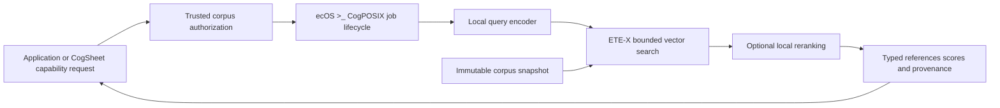

# ETE-X retrieval with ecOS >_ CogPOSIX

ETE-X, Early Termination Encoding, is an optional CPU-only retrieval engine built
to help make Sovereign AI practical. It can search an approved local document
corpus using compact non-autoregressive encoding and optional reranking. A
provisioned deployment runs without an API key or hosted inference service.

The developer integration connects ETE-X to the existing CogPOSIX C ABI through
a persistent local worker. It returns evidence that an application can inspect
and reuse: document identifiers, scores, source identities and execution metadata.
It is a retrieval capability, not a generative model or a replacement for the
LOGFORCE LFS Model Family.

## Retrieval architecture



The encoder represents the query as a vector. ETE-X uses compact codes and
conservative score bounds to exclude candidates that cannot enter the selected
top-k. It evaluates possible winners against their original vectors. Optional
reranking applies a second model to that bounded candidate set. Dense scores and
reranker logits retain separate meanings in the result.

The implementation contains row-wise, packed-v2 and mixed-v3 search code. The
current text worker admits row-wise and packed snapshots; mixed-v3 is not wired
into this document-search path. Exactness is relative to the documented eight-lane
FP64 reference scorer over stored FP32 vectors, with deterministic ID tie handling
and supported floating-point conditions. It does not imply exact agreement with
every other search engine, lossless INT8 models or perfect semantic relevance.

## Package contents and prerequisites

The [component source](https://github.com/logforce/ecosystem/tree/main/components/ete-x) includes the worker, schemas,
direct and C ABI clients, native search code, tests, two attributed compact ONNX
models and a verified snapshot of sixteen synthetic documents. The snapshot is a
functional demonstration, not a customer corpus or a relevance benchmark.

Real inference targets Linux x86-64, CPython 3.12 and a C++17 compiler. Rust 1.90.0
and Node.js 22+ are the reference development tools. Model/tokenizer identities,
snapshot files and dependency hashes are recorded separately. Native kernels
compile on first use into a writable runtime copy; the checked-in assets remain
unchanged. Other CPUs require qualification, even when a portable kernel runs.

Install the locked Python dependencies in a virtual environment as described in
the component README. A reviewed wheelhouse supports installation with
`--no-index --find-links`; provisioning is separate from offline inference.
The Linux wheel hashes do not declare support for another Python ABI or platform.

## Run the transport checks

```bash
python3 -I -B components/ete-x/integration/tests/run_tests.py --output-dir /tmp/etex-worker-checks
node components/ete-x/cogsheet/adapter.test.mjs
```

The worker fixture validates framing and failure behavior without model inference.
It is selected explicitly and rejects neural reranking. A model error never
silently changes a real search into a successful fixture response. Mapper tests
also validate recorded real results; that replay is not a fresh inference run.

## Build and run the native backend

The default community build does not compile or link ETE-X. Enable its separately
licensed backend deliberately:

```bash
cargo build --workspace --offline --locked --features etex
cargo test --workspace --offline --locked --features etex -- --test-threads=1
```

Create a private socket directory and start a daemon with approved local paths.
`ETEX_PYTHON` names the isolated interpreter and `ETEX_RUNTIME` the fresh runtime
copy prepared with `integration/prepare_runtime.py`. Do not reuse a public socket
directory or supply worker/model paths from a workbook.

```bash
ETEX_SOCKET_DIR=$(mktemp -d /tmp/etex-socket.XXXXXX)
chmod 700 "$ETEX_SOCKET_DIR"
target/debug/ecosd --socket "$ETEX_SOCKET_DIR/ecos.sock" \
  --etex-python "$ETEX_PYTHON" \
  --etex-worker "$PWD/components/ete-x/integration/worker.py" \
  --etex-engine etex --etex-root "$ETEX_RUNTIME" \
  --etex-snapshot "$ETEX_RUNTIME/commercial_lab/demo_snapshot" \
  --etex-encoder-dir "$ETEX_RUNTIME/commercial_lab/assets/models/minilm_encoder" \
  --etex-reranker-dir "$ETEX_RUNTIME/commercial_lab/assets/models/minilm_reranker" \
  --etex-strategy bounded --etex-threads 1 --etex-timeout-ms 120000
```

After `READY`, run the C ABI client from another terminal, retaining the same
interpreter and socket path:

```bash
"$ETEX_PYTHON" -I -B components/ete-x/integration/examples/cogposix_client.py \
  --library "$PWD/target/debug/libcogposix.so" \
  --socket "$ETEX_SOCKET_DIR/ecos.sock" \
  --query "How can local document retrieval protect data?" \
  --candidate-count 8 --top-k 3 --rerank
```

The current daemon selects one backend. Mock remains the default; the existing
digit-classification worker is unchanged and cannot be combined with ETE-X in one
daemon instance. The C header and ABI are unchanged. The ETE-X profile uses a
4096-byte U8 input envelope and a 65536-byte U8 output envelope, not arbitrary
streaming JSON or a dynamically discovered plugin registry.

## Application and CogSheet integration

The [semantic mapper](https://github.com/logforce/ecosystem/blob/main/components/ete-x/cogsheet/adapter.mjs) maps the
`etex.rag.search.v1` profile to [Capability Exchange v1](../contracts/capability/v1/README.md).
The host authenticates the caller, resolves an authorized corpus snapshot and
passes that trusted grant to the mapper. A workbook does not choose filesystem
paths or create its own authority. The response must match the admitted request,
snapshot digest, output budget, rerank selection and successful native status.

Results carry references and provenance for a cell to consume. Connecting the
mapper to the live CogSheet application, workbook revisions and its error display
remains application work. This release does not invent an available spreadsheet
function. Future cells can use the typed result while retaining visible errors,
source bindings and explicit execution permissions.

The supervisor manages worker startup, bounded pipes, deadlines, cancellation,
failure cleanup and restart on a separately submitted job. It is not a hostile-code
sandbox. Authentication, corpus access before text exposure, network isolation,
resource confinement and durable idempotency remain host responsibilities.

## Evidence and performance

The supplied 22 October 2026 handoff records 36 worker tests, 31 mapper checks and
47 Rust workspace tests, plus real encoder/search/reranker execution through the
C ABI. Those are distinct checks, not 114 independent model evaluations. The
repository retains [recorded real outputs](https://github.com/logforce/ecosystem/blob/main/components/ete-x/validation/ecos/c_abi_e2e.json)
as compatibility fixtures. New local validation must be identified separately.

A fresh [23 October 2026 qualification](https://github.com/logforce/ecosystem/blob/main/components/ete-x/validation/local-2026-10-23/qualification.json)
passed in a non-root Linux x86-64 container with networking disabled:

- 47 Rust workspace tests, 36 worker tests and 31 semantic-mapper tests passed.
- 73 numerical/model checks and two subtests passed. Two FP32 control checks were
  skipped because their larger source weights are not bundled.
- The real persistent worker encoded two queries and ran search plus reranking
  with the included compact models. Repeated identical requests preserved results.
- The native C ABI exercised real retrieval, fixture failure/recovery, eight
  rejected operator configurations, private socket permissions and cleanup.

The tested kernel was `portable_tile16_quad4`; this is not a new hardware-specific
latency measurement. The [reproduction commands](https://github.com/logforce/ecosystem/blob/main/components/ete-x/README.md#reproduce-the-full-qualification)
and per-suite records separate this new run from the original handoff evidence.

Standalone measurements concern specific laboratory configurations, not an
integrated platform speedup. The source records are retained in the component's
[standalone validation directory](https://github.com/logforce/ecosystem/tree/main/components/ete-x/validation/standalone):

| Experiment | Recorded result | Scope |
| --- | --- | --- |
| GloVe single-query packed-v2 search | 49.1% lower median search time than its paired control | Warm serial queries, one CPU, 1,183,514 vectors; not document relevance |
| DBpedia mixed-v3 vector search | 64.3% lower median search time than its paired control | 100,000 vectors, 60 held-out query rows, corpus-specific coordinate selection; not the text worker |
| Compact encoder and reranker pipeline | 42.1% lower median request latency | Four threads, 16 SciFact queries repeated three times; search backend unchanged |
| Two compact ONNX files | 74.7% fewer model-file bytes | 181,416,444 to 45,897,316 bytes; not a RAM, energy or cloud-bill measurement |

These gains must not be multiplied. The 16-query compact pipeline had lower
relevance than its FP32 control; a separate 300-query comparison had a confidence
interval including zero. A batch-32 BLAS scan was faster than repeated packed
searches. Auxiliary indexes increased stored vector payload in the measured
datasets. Integrated latency, customer-domain quality and production security
require their own evaluation.

## Licensing

ETE-X original source and the marked ETE-X integration use **CC BY-NC-ND 4.0**.
They are not covered by the community core's Apache-2.0 grant. Default builds
remain independent of this optional component. Third-party models keep their
own Apache-2.0 terms, model cards and transformation notices. See the
[component license](https://github.com/logforce/ecosystem/blob/main/components/ete-x/LICENSE.md),
[notices](https://github.com/logforce/ecosystem/blob/main/components/ete-x/NOTICE.md) and [project license scope](../LICENSE-SCOPE.md).
Commercial permissions beyond the ETE-X grant must be obtained separately.
